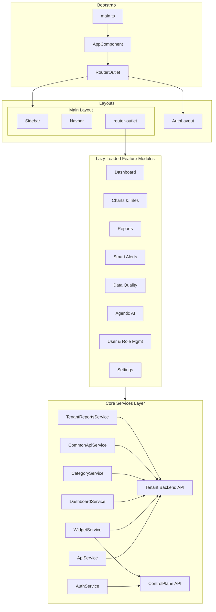

# Developer Documentation

## 1. Project Overview

**Application Name:** AI Tasnim — T-Wise (package name: `t-wise-dashboard-ui`)

**Purpose:** A multi-tenant enterprise analytics dashboard for Al Tasnim Enterprises LLC, providing operational intelligence across well monitoring, finance, workforce, projects, supply chain, and safety functions. The application enables users to create, publish, and view dashboards, charts, tiles, and reports sourced from configurable database connections.

**Main Application Areas:**

- Dashboard management (create, edit, publish, view operational dashboards)
- Charts & Tiles (custom data visualization widgets)
- Reports (tabular report building with RDLC export)
- Smart Alerts (alert rule configuration and monitoring)
- Data Quality (error log rules, self-healing AI, data dictionary)
- Agentic AI (AI agent management and activity logging)
- User & Role Management (users, roles, permissions)
- Settings (database view builder — SQL view definitions)

Report numeric-column inference samples up to 50 populated values, ignoring null,
missing, and whitespace-only cells. A majority of finite numbers or numeric strings
enables numeric operations, including Sum/Average in the report builder's Total
dropdown. Empty columns remain non-numeric; nulls are not replaced with zero.

Report numbers display without thousands-separator grouping in the builder,
viewer, and PDF output. Decimal precision remains at up to two places (four for
Northing/Easting); whole numbers stay unchanged. Excel numeric cells also use
ungrouped number formats.

Report body cells default to Excel-style alignment: numeric and date columns align
right; text and boolean columns align left. This applies to the builder and viewer
grids (including pinned summary rows) and to PDF and Excel exports. Manual per-cell
alignment wins, then report-wide alignment, then this default. Merged cells stay
centered unless manually aligned, group labels align left, and headers and the
Sl.No column remain centered.

Column group and sub-group headers can be aligned left, center, or right: click a
group/sub-group header in the builder grid (it is outlined), then use the toolbar
alignment buttons. Alignment is saved per name in `groupHeaderAlignments` and
`subGroupHeaderAlignments` (default center) and used by the builder, viewer, PDF,
and Excel. Report-wide alignment (nothing selected) also applies to group headers
and clears their overrides. Selecting a cell or column clears the group selection.

Template setups store column Group/Sub group on the source column, so grouping
survives Data Transformation `rename_column` rules whether the rename happens
before or after grouping. Applying a template from a different source copies
Group/Sub group onto same-named columns (case-insensitive) and skips columns the
target source does not have.

Applying a template keeps the report's own settings and skips template items for
columns the report does not have (`report-template-merge.util.ts`). Data
Transformation rules are dry-run on one synthetic row to find which columns exist,
so a template rule is accepted only when its columns exist after the rules before
it (columns created by earlier accepted rules count). A template rule replaces the
report's rule with the same action on the same column(s); identical rules are not
duplicated. Template conditional filters, conditional-formatting rules, DAX
measures and column-keyed formatting are likewise added only for existing columns
(so a filter on a missing column can no longer empty the report, and split/merge
rules can no longer add blank columns); the template wins only on the same key.
Row grouping changes only if the template defines it; row, page-row and summary-row
colors are merged. Non-column appearance (banner, fonts, theme, colors) still comes
from the template.

Renames never orphan formatting. Column-keyed formatting (header/cell colors, text
colors, alignment, orientation, borders, split cells, cell edits, inserted-row
values, row-group heading colors, merges, pins, data bars, conditional-formatting
rules, row grouping) is keyed by the displayed column name. The builder records
which renames those keys follow (`columnKeyRenames`); on every rebuild/history
capture, if the applied rename rules changed, every key moves to the column's new
name via its source column (`report-column-rename.util.ts`). Wholesale restores
(load, undo/redo, sheet switch) re-baseline instead of moving keys. DAX and
conditional filters that reference a rename output follow it too; references to
source names keep working through the existing source-name aliases. A rename onto
another existing column's name is ignored for re-keying. Column color, text color
and pins live on the source column config and are resolved for renamed columns in
the builder, viewer and exports. Saved templates key this formatting by source
column (`columnKeyBasis: 'source'`); applying one maps it onto the target's final
column names, converting legacy templates through their own rename rules. Drill to
Detail hides the internal original-name copy of renamed columns.

The auto-generated Sl.No (`__rowNumber__`) header follows the same saved header
background and text colors as data headers: a per-header override takes precedence
over All headers colors, otherwise the existing theme default is retained.
This applies to the live grid and Excel/HTML/print exports; numbering and body-cell
styling are unchanged.

In Appearance > Header and Footer Text, "Add Cluster Banner" defaults to checked
when a specific global cluster is selected and unchecked/disabled for All.
Changing the global cluster resets the checkbox to that selection's default;
users can manually uncheck it for the current selection. The banner requires both
a checked checkbox and a selected cluster. Its input is visible while checked but
disabled until the Edit button on its right is clicked. Editing updates the full
banner title immediately, with an informational note below the input. Cluster
changes disable editing again. Non-empty custom text persists across cluster
changes; clearing it restores the generated "REPORT NAME - CLUSTER NAME" title.
Banner settings are saved per sheet and restored with saved setups. The viewer,
expanded preview, and Excel/print exports use the same title and visibility rules.

In auto-size mode (the default), report builder and viewer grids widen each data
column to fit its longest formatted value on one line across every filtered row,
including other pages, later-loaded rows, and pinned total rows. This re-runs when
row data changes (for example, after a global filter change). Widths only grow, so
wider header-driven or manually resized widths are kept; fit-to-width mode is
unchanged. Vertical cells and row-group label columns do not drive these widths.

Right-click a pinned Sum, Avg, Count, or Total row in the report builder to change
that row's background or text color (Min/Max summaries use the same mechanism).
These options are not shown for regular data rows. Colors are saved per sheet in
`summaryRowColors` and `summaryRowTextColors`, keyed by summary label rather than
the pinned row's index, and restored by sheet undo/redo and saved setups.
They apply across the full row, including the serial/label cell, in the live
builder/viewer and Excel/print exports. Choosing None removes that override.
Pinned clicks never become data-row selections or write to data-cell color maps.

Generated row-group columns use their underlying grouping field's header formatting
(background, text color, alignment, orientation, and borders), including All headers
settings. With no selected header color they fall back to the grid theme.
Their body cells also follow the table border placement using the displayed column
order, while preserving row colors and independent pinned-summary colors. Builder,
expanded preview, and viewer share these callbacks; grouped headers also carry
their color classes into native Excel exports.

Report row-group headings store background/text overrides in `rowColorsByKey` and
`rowTextColorsByKey` using a `group:` key containing the full grouping field/value
path. Heading colors follow that group across expand/collapse, sorting, pagination,
sheet changes, saved reports, and Excel/print exports; they do not use row positions
or inherit data-row positional colors. Identical child labels under different
parents remain independent. Clearing an override restores the grouping field's
default color (if set). Hidden grouping fields remain available to the viewer,
and renamed fields resolve their saved grouping metadata back to their source.
Excel and PDF use the same heading override/default precedence. Positional cell/row
colors use the actual grid row position (including group headings), not the exported
leaf-row serial number; this prevents a heading's old positional paint from bleeding
onto the next data row. Inactive-sheet exports fall back to the expanded export row
positions. Collapsed leaves have no live positional paint, but retain stable-key,
column and conditional colors. Branded stripes use a separate leaf-only sequence,
so inserting group headings does not shift zebra striping.

Header colors remain independent of group-heading, data-row, and pinned-summary colors.

**Confirmed Technology Stack:**

| Layer              | Technology                                        | Version      |
| ------------------ | ------------------------------------------------- | ------------ |
| Framework          | Angular                                           | 22.x         |
| Language           | TypeScript                                        | 6.0.x        |
| Build Tool         | Angular CLI / esbuild (`@angular/build`)          | 22.0.5       |
| Charts             | Highcharts via `highcharts-angular`               | 13.x / 5.4.x |
| Data Grid          | AG Grid (`ag-grid-angular` / `ag-grid-community`) | 36.x         |
| Spreadsheet Export | SheetJS (`xlsx`)                                  | 0.18.x       |
| Styling            | SCSS with design-token variables                  | —            |
| Testing            | Vitest with jsdom                                 | 4.x / 28.x   |
| Formatter          | Prettier                                          | 3.8.x        |
| Package Manager    | npm                                               | 11.12.x      |
| RxJS               | RxJS                                              | 7.8.x        |

Source: `package.json`

---

## 2. Repository Structure

```
smartops/TWise.Frontend.Tenant/
├── angular.json                    # Angular workspace configuration
├── package.json                    # Dependencies and scripts
├── tsconfig.json                   # Root TypeScript config
├── tsconfig.app.json               # App-specific TS config
├── tsconfig.spec.json              # Test-specific TS config
├── proxy.conf.json                 # Dev server API proxy
├── .editorconfig                   # Editor formatting rules
├── .prettierrc                     # Prettier configuration
├── .gitignore
├── README.md
├── public/                         # Static assets served at root
├── src/
│   ├── index.html                  # HTML shell
│   ├── main.ts                     # Bootstrap entry point
│   ├── styles.scss                 # Global stylesheet entry
│   ├── styles/                     # SCSS design system partials
│   │   ├── _variables.scss         # Design tokens
│   │   ├── _theme.scss             # CSS custom properties
│   │   ├── _mixins.scss            # Reusable SCSS mixins
│   │   ├── _typography.scss        # Base typography
│   │   ├── _buttons.scss           # Button styles
│   │   ├── _forms.scss             # Form styles
│   │   ├── _tables.scss            # Table styles
│   │   ├── _layout.scss            # Layout shell styles
│   │   └── global.scss             # Aggregator importing all partials
│   ├── environments/
│   │   ├── environment.ts          # Development config
│   │   └── environment.prod.ts     # Production config
│   ├── assets/                     # Images, icons, fonts
│   └── app/
│       ├── app.ts                  # Root standalone component
│       ├── app.config.ts           # Application-level providers
│       ├── app.routes.ts           # Top-level route definitions
│       ├── app.html                # Root template (<router-outlet>)
│       ├── auth/                   # Authentication feature (lazy-loaded)
│       ├── core/                   # Singleton services, guards, interceptors
│       │   ├── config/             # Environment config wrapper
│       │   ├── constants/          # Route, API, menu, app constants
│       │   ├── guards/             # auth.guard, no-auth.guard
│       │   ├── helpers/            # NotificationHelper
│       │   ├── interceptors/       # auth.interceptor, error.interceptor
│       │   ├── models/             # TypeScript interfaces/DTOs
│       │   ├── services/           # Application-wide services
│       │   └── utils/              # DateUtil, StringUtil
│       ├── features/               # Feature modules (all lazy-loaded)
│       │   ├── dashboard/
│       │   ├── charts-tiles/
│       │   ├── reports/
│       │   ├── smart-alerts/
│       │   ├── data-quality/
│       │   ├── agentic-ai/
│       │   ├── user-role-management/
│       │   └── settings/
│       ├── layouts/                # Shell layouts
│       │   ├── auth-layout/        # Login/forgot-password shell
│       │   └── main-layout/        # Sidebar + navbar + content shell
│       └── shared/                 # SharedModule (components, pipes, directives)
```

---

## 3. Architecture

The application uses a **standalone root component** bootstrapped with Angular's `bootstrapApplication()` and a provider-based configuration (`app.config.ts`). Feature areas are **lazy-loaded NgModules** reached through the router.



**Key architectural decisions:**

- Root component (`AppComponent`) is standalone; feature modules use `NgModule`-based declarations.
- All HTTP calls pass through two functional interceptors registered in `app.config.ts`: `authInterceptor` (attaches JWT) and `errorInterceptor` (handles 401 → redirect to login).
- A global `ErrorHandler` is overridden with `GlobalErrorHandlerService`.
- State is managed via RxJS `BehaviorSubject` streams in services and Angular `signal()` for simpler local state. No external state management library (NgRx, Akita, etc.) is used.
- The application communicates with two backend APIs: a **ControlPlane API** (auth, widget library) and a **Tenant API** (domain data).

Source: `src/app/app.config.ts`, `src/app/app.routes.ts`

---

## 4. Application Entry Points

| Step           | File                    | Responsibility                                                                             |
| -------------- | ----------------------- | ------------------------------------------------------------------------------------------ |
| HTML shell     | `src/index.html`        | Loads Inter font, mounts `<app-root>`                                                      |
| Bootstrap      | `src/main.ts`           | Calls `bootstrapApplication(AppComponent, appConfig)`                                      |
| Root component | `src/app/app.ts`        | Standalone component with `<router-outlet>`                                                |
| App config     | `src/app/app.config.ts` | Registers router, HTTP client with interceptors, Highcharts provider, global error handler |
| Routes         | `src/app/app.routes.ts` | Defines top-level routes with guards and lazy-loaded children                              |

---

## 5. Routing

### Top-Level Routes

| Route                      | Layout                | Guard         | Module (lazy)              | Purpose                              |
| -------------------------- | --------------------- | ------------- | -------------------------- | ------------------------------------ |
| `/`                        | —                     | —             | —                          | Redirects to `/dashboard`            |
| `/auth/**`                 | `AuthLayoutComponent` | `noAuthGuard` | `AuthModule`               | Login, forgot password               |
| `/dashboard/**`            | `MainLayoutComponent` | `authGuard`   | `DashboardModule`          | Dashboard CRUD                       |
| `/charts-tiles/**`         | `MainLayoutComponent` | `authGuard`   | `ChartsTilesModule`        | Chart/tile CRUD                      |
| `/reports/**`              | `MainLayoutComponent` | `authGuard`   | `ReportsModule`            | Report CRUD                          |
| `/smart-alerts/**`         | `MainLayoutComponent` | `authGuard`   | `SmartAlertsModule`        | Alert management                     |
| `/data-quality/**`         | `MainLayoutComponent` | `authGuard`   | `DataQualityModule`        | Data quality tools                   |
| `/agentic-ai/**`           | `MainLayoutComponent` | `authGuard`   | `AgenticAiModule`          | AI agent management                  |
| `/user-role-management/**` | `MainLayoutComponent` | `authGuard`   | `UserRoleManagementModule` | User/role admin                      |
| `/settings/**`             | `MainLayoutComponent` | `authGuard`   | `SettingsModule`           | Database views                       |
| `**`                       | —                     | —             | —                          | Wildcard → redirects to `/dashboard` |

Source: `src/app/app.routes.ts`, `src/app/core/constants/route.constants.ts`

### Feature Child Routes

<details>
<summary>Auth Routes</summary>

| Route                   | Component                 |
| ----------------------- | ------------------------- |
| `/auth/login`           | `LoginComponent`          |
| `/auth/forgot-password` | `ForgotPasswordComponent` |

Source: `src/app/auth/auth-routing.module.ts`
</details>

<details>
<summary>Dashboard Routes</summary>

| Route                                 | Component                      |
| ------------------------------------- | ------------------------------ |
| `/dashboard`                          | Redirects to `my-boards`       |
| `/dashboard/standard-boards`          | `StandardBoardsComponent`      |
| `/dashboard/my-boards`                | `MyBoardsComponent`            |
| `/dashboard/builder`                  | `DashboardBuilderComponent`    |
| `/dashboard/builder/:id`              | `DashboardBuilderComponent`    |
| `/dashboard/operations-dashboard/:id` | `OperationsDashboardComponent` |

Source: `src/app/features/dashboard/dashboard-routing.module.ts`
</details>

<details>
<summary>Charts & Tiles Routes</summary>

| Route                            | Component                 | Data                    |
| -------------------------------- | ------------------------- | ----------------------- |
| `/charts-tiles/standard-charts`  | `StandardChartsComponent` | `{ mode: 'standard' }`  |
| `/charts-tiles/published-charts` | `StandardChartsComponent` | `{ mode: 'published' }` |
| `/charts-tiles/my-charts`        | `MyChartsComponent`       | `{ mode: 'my' }`        |
| `/charts-tiles/wip-charts`       | `MyChartsComponent`       | `{ mode: 'wip' }`       |
| `/charts-tiles/wip-tiles`        | `WipTilesComponent`       | `{ mode: 'wip' }`       |
| `/charts-tiles/my-tiles`         | `WipTilesComponent`       | `{ mode: 'my' }`        |
| `/charts-tiles/published-tiles`  | `WipTilesComponent`       | `{ mode: 'published' }` |
| `/charts-tiles/standard-tiles`   | `WipTilesComponent`       | `{ mode: 'standard' }`  |
| `/charts-tiles/builder`          | `ChartBuilderComponent`   | —                       |
| `/charts-tiles/edit/:id`         | `ChartBuilderComponent`   | —                       |
| `/charts-tiles/tile-builder`     | `TileBuilderComponent`    | —                       |
| `/charts-tiles/view/:id`         | `WidgetViewComponent`     | —                       |

Source: `src/app/features/charts-tiles/charts-tiles-routing.module.ts`
</details>

<details>
<summary>Reports Routes</summary>

| Route                       | Component                  |
| --------------------------- | -------------------------- |
| `/reports/standard-reports` | `StandardReportsComponent` |
| `/reports/my-reports`       | `MyReportsComponent`       |
| `/reports/builder`          | `ReportBuilderComponent`   |
| `/reports/view/:id`         | `ReportViewerComponent`    |

Source: `src/app/features/reports/reports-routing.module.ts`
</details>

<details>
<summary>Smart Alerts Routes</summary>

| Route                                           | Component                         |
| ----------------------------------------------- | --------------------------------- |
| `/smart-alerts/alerts`                          | `AlertsComponent`                 |
| `/smart-alerts/alert-rule-configuration`        | `AlertRuleConfigurationComponent` |
| `/smart-alerts/alert-rule-configuration/create` | `AlertRuleBuilderComponent`       |
| `/smart-alerts/alert-rule-configuration/:id`    | `AlertRuleDetailComponent`        |

Source: `src/app/features/smart-alerts/smart-alerts-routing.module.ts`
</details>

<details>
<summary>Data Quality Routes</summary>

| Route                                    | Component                    |
| ---------------------------------------- | ---------------------------- |
| `/data-quality/error-log-rules`          | `ErrorLogRulesComponent`     |
| `/data-quality/error-log-rules/add-rule` | `AddValidationRuleComponent` |
| `/data-quality/self-healing-ai`          | `SelfHealingAiComponent`     |
| `/data-quality/data-dictionary`          | `DataDictionaryComponent`    |

Source: `src/app/features/data-quality/data-quality-routing.module.ts`
</details>

<details>
<summary>Agentic AI Routes</summary>

| Route                       | Component              |
| --------------------------- | ---------------------- |
| `/agentic-ai/ai-agents`     | `AiAgentsComponent`    |
| `/agentic-ai/ai-agents/new` | `NewAgentComponent`    |
| `/agentic-ai/activity-log`  | `ActivityLogComponent` |

Source: `src/app/features/agentic-ai/agentic-ai-routing.module.ts`
</details>

<details>
<summary>User & Role Management Routes</summary>

| Route                                     | Component                   |
| ----------------------------------------- | --------------------------- |
| `/user-role-management/users`             | `UsersComponent`            |
| `/user-role-management/roles-permissions` | `RolesPermissionsComponent` |

Source: `src/app/features/user-role-management/user-role-management-routing.module.ts`
</details>

<details>
<summary>Settings Routes</summary>

| Route                             | Component                      |
| --------------------------------- | ------------------------------ |
| `/settings/database-view`         | `DatabaseViewComponent`        |
| `/settings/database-view/builder` | `DatabaseViewBuilderComponent` |
| `/settings/database-view/:id`     | `DatabaseViewDetailComponent`  |

Source: `src/app/features/settings/settings-routing.module.ts`
</details>

---

## 6. Feature Modules / Feature Areas

### 6.1 Dashboard

- **Location:** `src/app/features/dashboard/`
- **Purpose:** Create, edit, publish, and view operational dashboards with drag-and-drop widget composition.
- **Main Components:** `StandardBoardsComponent`, `MyBoardsComponent`, `DashboardBuilderComponent`, `OperationsDashboardComponent`
- **Services Used:** `DashboardService`, `CategoryService`, `WidgetService`
- **External Dependencies:** `highcharts-angular` (imported in module)
- **State:** `DashboardService` holds WIP and Published dashboards in `BehaviorSubject` streams with load-once caching.

Source: `src/app/features/dashboard/dashboard.module.ts`

### 6.2 Charts & Tiles

- **Location:** `src/app/features/charts-tiles/`
- **Purpose:** Create and manage individual chart and tile widgets. Provides a visual chart builder and tile builder.
- **Main Components:** `StandardChartsComponent`, `MyChartsComponent`, `WipTilesComponent`, `ChartBuilderComponent`, `TileBuilderComponent`, `WidgetViewComponent`, `ChartCardPreviewComponent`
- **Services Used:** `WidgetService`, `CommonApiService`, `CategoryService`
- **External Dependencies:** `highcharts-angular`
- **Route Data:** Components reuse across multiple routes via `data: { mode }` to distinguish standard/published/my/wip views.

Source: `src/app/features/charts-tiles/charts-tiles.module.ts`

### 6.3 Reports

- **Location:** `src/app/features/reports/`
- **Purpose:** Create, manage, and export tabular reports with configurable data sources.
- **Main Components:** `StandardReportsComponent`, `MyReportsComponent`, `ReportBuilderComponent`, `ReportViewerComponent`
- **Services Used:** `TenantReportsService`, `CommonApiService`, `CategoryService`
- **Export Formats:** PDF, Excel, Word (via backend RDLC export endpoint).

Source: `src/app/features/reports/reports.module.ts`

### 6.4 Smart Alerts

- **Location:** `src/app/features/smart-alerts/`
- **Purpose:** Configure and monitor alert rules against data thresholds.
- **Main Components:** `AlertsComponent`, `AlertRuleConfigurationComponent`, `AlertRuleBuilderComponent`, `AlertRuleDetailComponent`
- **External Dependencies:** `ag-grid-angular` (for alert rule grid)
- **Custom AG Grid Cell Renderers:** `ArcRuleNameRendererComponent`, `ArcTriggerRendererComponent`, `ArcSeverityRendererComponent`, `ArcStatusRendererComponent`

Source: `src/app/features/smart-alerts/smart-alerts.module.ts`

### 6.5 Data Quality

- **Location:** `src/app/features/data-quality/`
- **Purpose:** Error log and validation rules, self-healing AI suggestions, data dictionary.
- **Main Components:** `DataQualityComponent` (shell with child routes), `ErrorLogRulesComponent`, `SelfHealingAiComponent`, `DataDictionaryComponent`, `AddValidationRuleComponent`
- **External Dependencies:** `highcharts-angular`, `ag-grid-angular`

Source: `src/app/features/data-quality/data-quality.module.ts`

### 6.6 Agentic AI

- **Location:** `src/app/features/agentic-ai/`
- **Purpose:** Manage AI agents and view their activity logs.
- **Main Components:** `AgenticAiComponent` (shell), `AiAgentsComponent`, `ActivityLogComponent`, `NewAgentComponent`
- **External Dependencies:** `ag-grid-angular`

Source: `src/app/features/agentic-ai/agentic-ai.module.ts`

### 6.7 User & Role Management

- **Location:** `src/app/features/user-role-management/`
- **Purpose:** Administer users and configure role-based permissions.
- **Main Components:** `UsersComponent`, `RolesPermissionsComponent`, `CreateUserModalComponent`
- **External Dependencies:** `ag-grid-angular`
- **Custom AG Grid Cell Renderers:** `EmployeeCellRendererComponent`, `RoleCellRendererComponent`, `StatusCellRendererComponent`, `ActionsCellRendererComponent`

Source: `src/app/features/user-role-management/user-role-management.module.ts`

### 6.8 Settings

- **Location:** `src/app/features/settings/`
- **Purpose:** Database view builder — allows constructing SQL views from registered database connections with visual join/filter tools.
- **Main Components:** `SettingsComponent` (shell), `DatabaseViewComponent`, `DatabaseViewBuilderComponent`, `DatabaseViewDetailComponent`
- **External Dependencies:** `ag-grid-angular`
- **Custom AG Grid Cell Renderers:** `ViewNameCellRendererComponent`, `TablesCellRendererComponent`, `SourceCellRendererComponent`, `DbActionsCellRendererComponent`

Source: `src/app/features/settings/settings.module.ts`

---

## 7. Components

### Layouts

| Component             | Path                                   | Selector          | Responsibility                                                                               |
| --------------------- | -------------------------------------- | ----------------- | -------------------------------------------------------------------------------------------- |
| `AuthLayoutComponent` | `src/app/layouts/auth-layout/`         | `app-auth-layout` | Two-panel login shell (hero + form panel)                                                    |
| `MainLayoutComponent` | `src/app/layouts/main-layout/`         | `app-main-layout` | Sidebar + navbar + content + footer                                                          |
| `SidebarComponent`    | `src/app/layouts/main-layout/sidebar/` | `app-sidebar`     | Collapsible navigation menu with role filtering and search                                   |
| `NavbarComponent`     | `src/app/layouts/main-layout/navbar/`  | `app-navbar`      | Top header with breadcrumbs, AI assistant panel, notifications, user menu, font-size control |

### Shared Components

| Component                     | Selector                  | Inputs                                                                  | Outputs                  | Purpose                                                  |
| ----------------------------- | ------------------------- | ----------------------------------------------------------------------- | ------------------------ | -------------------------------------------------------- |
| `ButtonComponent`             | `app-button`              | `variant`, `size`, `disabled`, `loading`, `fullWidth`, `type`           | `clicked`                | Configurable button with loading state                   |
| `CardComponent`               | `app-card`                | `title`, `subtitle`, `padding`                                          | —                        | Generic content card                                     |
| `LoaderComponent`             | `app-loader`              | `size`, `overlay`, `message`                                            | —                        | Loading spinner with optional overlay                    |
| `EmptyStateComponent`         | `app-empty-state`         | `title`, `description`, `icon`, `image`                                 | —                        | Placeholder for empty data states                        |
| `PageHeaderComponent`         | `app-page-header`         | `title`, `subtitle`, `breadcrumbs`                                      | —                        | Publishes breadcrumbs to navbar via `BreadcrumbService`  |
| `ConfirmationDialogComponent` | `app-confirmation-dialog` | `isOpen`, `title`, `message`, `confirmLabel`, `cancelLabel`, `variant`  | `confirmed`, `cancelled` | Generic confirm/cancel modal                             |
| `CategoryManagerComponent`    | `app-category-manager`    | `isOpen`, `controlType`                                                 | `closed`                 | CRUD slide-over panel for categories                     |
| `MultiSelectComponent`        | `app-multi-select`        | `label`, `required`, `placeholder`, `options`, `selectedIds`, `invalid` | `selectedIdsChange`      | Multi-select dropdown with chips                         |
| `AdvancedFilterComponent`     | `app-advanced-filter`     | —                                                                       | `applied`                | Fixed-position filter panel for well hierarchy filtering |
| `IconComponent`               | `app-icon`                | `name`                                                                  | —                        | Renders SVG icons by name (standalone)                   |
| `ProductTourComponent`        | `app-product-tour`        | —                                                                       | —                        | Guided product tour overlay (standalone)                 |
| `ChartCardPreviewComponent`   | `app-chart-card-preview`  | `widget`                                                                | —                        | Lazy-loaded Highcharts preview for widget cards          |

Source: `src/app/shared/shared.module.ts`, `src/app/shared/components/`

---

## 8. Services

| Service                     | Path                                                    | Responsibility                                                                                                         | Key Dependencies                               |
| --------------------------- | ------------------------------------------------------- | ---------------------------------------------------------------------------------------------------------------------- | ---------------------------------------------- |
| `ApiService`                | `src/app/core/services/api.service.ts`                  | Base HTTP wrapper (GET/POST/PUT/PATCH/DELETE) against Tenant API                                                       | `HttpClient`                                   |
| `AuthService`               | `src/app/core/services/auth.service.ts`                 | Login/logout, current user signal, role checks                                                                         | `HttpClient`, `TokenService`, `StorageService` |
| `TokenService`              | `src/app/core/services/token.service.ts`                | Reads/writes JWT access/refresh tokens in localStorage                                                                 | `StorageService`                               |
| `StorageService`            | `src/app/core/services/storage.service.ts`              | Safe localStorage wrapper (handles exceptions)                                                                         | —                                              |
| `DashboardService`          | `src/app/core/services/dashboard.service.ts`            | Dashboard CRUD, publish, toggle-active; caches via BehaviorSubject                                                     | `ApiService`                                   |
| `CategoryService`           | `src/app/core/services/category.service.ts`             | Category CRUD with reactive cache by controlType                                                                       | `ApiService`                                   |
| `WidgetService`             | `src/app/core/services/widget.service.ts`               | Chart/tile CRUD, widget library from ControlPlane, user preferences (favourites, recently viewed), filtered chart data | `HttpClient`, `ApiService`                     |
| `CommonApiService`          | `src/app/core/services/common-api.service.ts`           | Sources, table data, database connections, schema, database views CRUD, preview                                        | `HttpClient`                                   |
| `TenantReportsService`      | `src/app/core/services/tenant-reports.service.ts`       | Report CRUD and blob export (PDF/Excel/Word)                                                                           | `HttpClient`                                   |
| `BreadcrumbService`         | `src/app/core/services/breadcrumb.service.ts`           | Publishes breadcrumb trail from page headers to navbar                                                                 | —                                              |
| `LayoutStateService`        | `src/app/core/services/layout-state.service.ts`         | Sidebar collapse/expand state via BehaviorSubject                                                                      | —                                              |
| `FontSizeService`           | `src/app/core/services/font-size.service.ts`            | App-wide zoom level (85–115%) persisted to localStorage                                                                | `StorageService`                               |
| `ToastService`              | `src/app/core/services/toast.service.ts`                | Pending message transport between page navigations                                                                     | —                                              |
| `ProductTourService`        | `src/app/core/services/product-tour.service.ts`         | Guided tour step management (start, next, skip)                                                                        | —                                              |
| `GlobalErrorHandlerService` | `src/app/core/services/global-error-handler.service.ts` | Catches unhandled errors and logs to console                                                                           | —                                              |

---

## 9. API Integration

The application communicates with two distinct backend APIs:

1. **ControlPlane API** — Authentication, widget library templates
2. **Tenant API** — All domain data operations (dashboards, widgets, reports, categories, database views, etc.)

### Verified Endpoints

| Service                | HTTP Method | Endpoint                                        | Purpose                           | Source                                            |
| ---------------------- | ----------- | ----------------------------------------------- | --------------------------------- | ------------------------------------------------- |
| `AuthService`          | POST        | `{controlPlaneApiUrl}/auth/login`               | User login                        | `src/app/core/services/auth.service.ts`           |
| `WidgetService`        | GET         | `{controlPlaneApiUrl}/widget-library?type=`     | Fetch widget templates            | `src/app/core/services/widget.service.ts`         |
| `DashboardService`     | GET         | `{tenantApiUrl}/dashboard/wip`                  | List WIP dashboards               | `src/app/core/services/dashboard.service.ts`      |
| `DashboardService`     | GET         | `{tenantApiUrl}/dashboard/published`            | List published dashboards         | `src/app/core/services/dashboard.service.ts`      |
| `DashboardService`     | GET         | `{tenantApiUrl}/dashboard/categories`           | Dashboard categories dropdown     | `src/app/core/services/dashboard.service.ts`      |
| `DashboardService`     | GET         | `{tenantApiUrl}/dashboard/{id}`                 | Dashboard detail with widgets     | `src/app/core/services/dashboard.service.ts`      |
| `DashboardService`     | GET         | `{tenantApiUrl}/dashboard/widgets/library`      | Active charts & tiles for builder | `src/app/core/services/dashboard.service.ts`      |
| `DashboardService`     | POST        | `{tenantApiUrl}/dashboard`                      | Create dashboard                  | `src/app/core/services/dashboard.service.ts`      |
| `DashboardService`     | PUT         | `{tenantApiUrl}/dashboard/{id}`                 | Update dashboard                  | `src/app/core/services/dashboard.service.ts`      |
| `DashboardService`     | DELETE      | `{tenantApiUrl}/dashboard/{id}`                 | Delete dashboard                  | `src/app/core/services/dashboard.service.ts`      |
| `DashboardService`     | POST        | `{tenantApiUrl}/dashboard/{id}/publish`         | Publish dashboard                 | `src/app/core/services/dashboard.service.ts`      |
| `DashboardService`     | PATCH       | `{tenantApiUrl}/dashboard/{id}/toggle-active`   | Toggle active state               | `src/app/core/services/dashboard.service.ts`      |
| `CategoryService`      | GET         | `{tenantApiUrl}/category?controlType=`          | List categories                   | `src/app/core/services/category.service.ts`       |
| `CategoryService`      | POST        | `{tenantApiUrl}/category`                       | Create category                   | `src/app/core/services/category.service.ts`       |
| `CategoryService`      | PUT         | `{tenantApiUrl}/category/{id}`                  | Update category                   | `src/app/core/services/category.service.ts`       |
| `CategoryService`      | DELETE      | `{tenantApiUrl}/category/{id}`                  | Delete category                   | `src/app/core/services/category.service.ts`       |
| `WidgetService`        | GET         | `{tenantApiUrl}/widgets?status=&type=`          | List widgets                      | `src/app/core/services/widget.service.ts`         |
| `WidgetService`        | GET         | `{tenantApiUrl}/widgets/{id}`                   | Get widget by ID                  | `src/app/core/services/widget.service.ts`         |
| `WidgetService`        | POST        | `{tenantApiUrl}/widgets`                        | Create widget                     | `src/app/core/services/widget.service.ts`         |
| `WidgetService`        | PUT         | `{tenantApiUrl}/widgets/{id}`                   | Update widget                     | `src/app/core/services/widget.service.ts`         |
| `WidgetService`        | DELETE      | `{tenantApiUrl}/widgets/{id}`                   | Delete widget                     | `src/app/core/services/widget.service.ts`         |
| `WidgetService`        | POST        | `{tenantApiUrl}/preferences/favourite`          | Toggle favourite                  | `src/app/core/services/widget.service.ts`         |
| `WidgetService`        | POST        | `{tenantApiUrl}/preferences/view`               | Track view                        | `src/app/core/services/widget.service.ts`         |
| `WidgetService`        | GET         | `{tenantApiUrl}/preferences/favourites`         | Get favourites                    | `src/app/core/services/widget.service.ts`         |
| `WidgetService`        | GET         | `{tenantApiUrl}/preferences/recently-viewed`    | Recently viewed                   | `src/app/core/services/widget.service.ts`         |
| `CommonApiService`     | GET         | `{apiBaseUrl}/common/sources`                   | List table/view sources           | `src/app/core/services/common-api.service.ts`     |
| `CommonApiService`     | GET         | `{apiBaseUrl}/common/table-data`                | Preview data from source          | `src/app/core/services/common-api.service.ts`     |
| `CommonApiService`     | GET         | `{apiBaseUrl}/database-connections`             | List DB connections               | `src/app/core/services/common-api.service.ts`     |
| `CommonApiService`     | GET         | `{apiBaseUrl}/database-connections/{id}/schema` | Full table/column schema          | `src/app/core/services/common-api.service.ts`     |
| `CommonApiService`     | GET         | `{apiBaseUrl}/database-views`                   | List saved views                  | `src/app/core/services/common-api.service.ts`     |
| `CommonApiService`     | GET         | `{apiBaseUrl}/database-views/{id}`              | Get single view                   | `src/app/core/services/common-api.service.ts`     |
| `CommonApiService`     | POST        | `{apiBaseUrl}/database-views`                   | Create view                       | `src/app/core/services/common-api.service.ts`     |
| `CommonApiService`     | PUT         | `{apiBaseUrl}/database-views/{id}`              | Update view                       | `src/app/core/services/common-api.service.ts`     |
| `CommonApiService`     | DELETE      | `{apiBaseUrl}/database-views/{id}`              | Delete view                       | `src/app/core/services/common-api.service.ts`     |
| `CommonApiService`     | POST        | `{apiBaseUrl}/database-views/preview`           | Run SQL preview                   | `src/app/core/services/common-api.service.ts`     |
| `WidgetService`        | POST        | `{tenantApiUrl}/common/chart-data/filtered`     | Filtered chart data               | `src/app/core/services/widget.service.ts`         |
| `TenantReportsService` | GET         | `{apiBaseUrl}/reports`                          | List reports                      | `src/app/core/services/tenant-reports.service.ts` |
| `TenantReportsService` | GET         | `{apiBaseUrl}/reports/{id}`                     | Get report                        | `src/app/core/services/tenant-reports.service.ts` |
| `TenantReportsService` | POST        | `{apiBaseUrl}/reports`                          | Create report                     | `src/app/core/services/tenant-reports.service.ts` |
| `TenantReportsService` | PUT         | `{apiBaseUrl}/reports/{id}`                     | Update report                     | `src/app/core/services/tenant-reports.service.ts` |
| `TenantReportsService` | DELETE      | `{apiBaseUrl}/reports/{id}`                     | Delete report                     | `src/app/core/services/tenant-reports.service.ts` |
| `TenantReportsService` | GET         | `{apiBaseUrl}/reports/{id}/export?format=`      | Export report as file             | `src/app/core/services/tenant-reports.service.ts` |

---

## 10. Authentication and Authorization

### Authentication Flow

1. User navigates to `/auth/login`.
2. `LoginComponent` submits credentials (`email`, `password`) via `AuthService.login()`.
3. `AuthService` POSTs to `{controlPlaneApiUrl}/auth/login`.
4. On success, the JWT token is stored in `localStorage` (`tw_access_token`) via `TokenService`. User data is stored in `localStorage` (`tw_user_data`).
5. User is redirected to `/dashboard`.
6. On explicit logout, `AuthService.logout()` captures the refresh token, clears local tokens, user data and caches, then POSTs `{ refreshToken }` to `{controlPlaneApiUrl}/auth/logout`. The navbar redirects to login immediately. The request has a five-second timeout; network/API failures do not prevent local logout, but server revocation is only confirmed by a successful response.
7. Automatic session-expiry handling uses `AuthService.clearSession()` without sending a logout request. Logout responses never trigger token refresh or clear a newly signed-in session.

The ControlPlane endpoint returns `204` for a valid current-session revocation (including repeated requests), `400` for invalid input, and `401` for invalid refresh credentials. Access and refresh tokens share a persisted session ID, so logout invalidates that session's renewed tokens as well, without revoking other login sessions. The Tenant API honors the same revocation through its existing ControlPlane `/auth/session` check.

**Deployment prerequisite:** Apply `smartops/infra/sql/add-user-sessions.sql` to the configured ControlPlane database before deploying/restarting the updated ControlPlane API, then deploy the frontend. The schema is not created automatically. Existing tokens without session IDs require a new login once after rollout. This script does not modify users or passwords.

Source: `src/app/core/services/auth.service.ts`, `src/app/auth/login/login.component.ts`

### Token Handling

- `authInterceptor` attaches `Authorization: Bearer <token>` to every outgoing request.
- Authentication is required in development and production; there is no development bypass.
- `errorInterceptor` attempts a one-time token refresh for protected API HTTP 401 responses and retries the request. Missing or rejected refresh credentials, or a retry that is still unauthorized, end the session and redirect to `/auth/login`.

Source: `src/app/core/interceptors/auth.interceptor.ts`, `src/app/core/interceptors/error.interceptor.ts`

### Guards

| Guard         | File                                   | Behavior                                                                                      |
| ------------- | -------------------------------------- | --------------------------------------------------------------------------------------------- |
| `authGuard`   | `src/app/core/guards/auth.guard.ts`    | Allows access if `AuthService.isAuthenticated()` returns `true`; otherwise redirects to login |
| `noAuthGuard` | `src/app/core/guards/no-auth.guard.ts` | Allows access only if user is NOT authenticated; otherwise redirects to `/dashboard`          |

### Role-Based Access

- The sidebar (`SidebarComponent`) filters menu items by the `roles` array on each `MenuItem` child using the current user's role.
- `HasRoleDirective` (`*appHasRole`) conditionally renders template content based on the user's role.
- Roles observed in the codebase: `admin`, `operator`, `viewer`.

Source: `src/app/layouts/main-layout/sidebar/sidebar.component.ts`, `src/app/shared/directives/has-role.directive.ts`, `src/app/core/constants/menu.constants.ts`

---

## 11. State Management

No dedicated state management library is used. The application employs:

| Pattern                | Where Used                                                                                                                                    | Example                                                                   |
| ---------------------- | --------------------------------------------------------------------------------------------------------------------------------------------- | ------------------------------------------------------------------------- |
| Angular `signal()`     | `AuthService.currentUser`, `BreadcrumbService.crumbs`, `LoginComponent.isLoading`                                                             | Local/service reactive state                                              |
| RxJS `BehaviorSubject` | `DashboardService.wipSubject`, `CategoryService.categoriesSubject`, `LayoutStateService._sidebarCollapsed`, `ProductTourService.stateSubject` | Shared observable streams                                                 |
| Load-once caching      | `DashboardService`, `CategoryService`                                                                                                         | Data fetched once then served from cache; explicit `refresh()` re-fetches |

Source: `src/app/core/services/dashboard.service.ts`, `src/app/core/services/auth.service.ts`, `src/app/core/services/layout-state.service.ts`

---

## 12. Forms and Validation

### Login Form

- **Type:** Reactive (`FormGroup`)
- **Fields:** `email` (required, email validator), `password` (required, minLength 6)
- **Behavior:** Marks all controls as touched on invalid submit; shows inline field errors.

Source: `src/app/auth/login/login.component.ts`

### Forgot Password Form

- **Type:** Reactive (`FormGroup`)
- **Fields:** `email` (required, email validator)
- **Behavior:** Simulates sending a reset link (no API call implemented).

Source: `src/app/auth/forgot-password/forgot-password.component.ts`

### Custom Validators

| Validator                   | File                                              | Purpose                                                          |
| --------------------------- | ------------------------------------------------- | ---------------------------------------------------------------- |
| `emailDomainValidator`      | `src/app/shared/validators/email.validator.ts`    | Restricts email to specific allowed domains                      |
| `passwordStrengthValidator` | `src/app/shared/validators/password.validator.ts` | Requires uppercase, lowercase, number, special char, min 8 chars |
| `passwordMatchValidator`    | `src/app/shared/validators/password.validator.ts` | Cross-field validator ensuring password and confirm match        |

---

## 13. Error Handling

| Layer                   | Mechanism                                                         | Source                                                  |
| ----------------------- | ----------------------------------------------------------------- | ------------------------------------------------------- |
| Global unhandled errors | `GlobalErrorHandlerService` logs to `console.error`               | `src/app/core/services/global-error-handler.service.ts` |
| HTTP 401                | `errorInterceptor` clears session and redirects to login          | `src/app/core/interceptors/error.interceptor.ts`        |
| HTTP errors in services | Passed to subscribers via `throwError(() => error)`               | `src/app/core/interceptors/error.interceptor.ts`        |
| Component-level         | `NotificationHelper` shows timed success/error messages           | `src/app/core/helpers/notification.helper.ts`           |
| Login errors            | `LoginComponent` displays `errorMessage` signal from API response | `src/app/auth/login/login.component.ts`                 |

The application does not integrate an external error monitoring service (a TODO comment in `GlobalErrorHandlerService` mentions Sentry as a potential future integration).

---

## 14. Configuration

### Environment Files

| File                                   | Purpose              |
| -------------------------------------- | -------------------- |
| `src/environments/environment.ts`      | Development settings |
| `src/environments/environment.prod.ts` | Production settings  |

**Non-sensitive settings exposed:**

| Key          | Dev Value | Prod Value |
| ------------ | --------- | ---------- |
| `production` | `false`   | `true`     |
| `appVersion` | `v1.0.0`  | `v1.0.0`   |

The `apiBaseUrl`, `tenantApiUrl`, and `controlPlaneApiUrl` configure backend connectivity (values redacted for security).

Source: `src/environments/environment.ts`, `src/environments/environment.prod.ts`

### Build Configurations

| Configuration | File Replacement                         | Optimizations                                               |
| ------------- | ---------------------------------------- | ----------------------------------------------------------- |
| `production`  | `environment.ts` → `environment.prod.ts` | Output hashing, budgets (500kB warning / 1MB error initial) |
| `development` | None                                     | No optimization, source maps enabled                        |

Source: `angular.json`

### Proxy Configuration (Development Only)

| Path          | Target                  | Rewrite                             |
| ------------- | ----------------------- | ----------------------------------- |
| `/api/tenant` | `http://localhost:5069` | Strip `/api/tenant` prefix → `/api` |

Source: `proxy.conf.json`

---

## 15. Development Setup

### Prerequisites

- Node.js (version compatible with npm 11.12.x)
- npm 11.12.x (declared in `packageManager` field)

### Installation

```bash
cd smartops/TWise.Frontend.Tenant
npm install
```

### Available Scripts

| Command         | Purpose                                                                  |
| --------------- | ------------------------------------------------------------------------ |
| `npm start`     | Serve locally with API proxy (`ng serve --proxy-config proxy.conf.json`) |
| `npm run build` | Production build (`ng build`)                                            |
| `npm run watch` | Development build in watch mode                                          |
| `npm test`      | Run unit tests via Vitest                                                |

Source: `package.json`

### Local Development

The app serves on `http://localhost:4200/` by default. The proxy forwards `/api/tenant` requests to a local Tenant API at `http://localhost:5069`.

For Windows terminal crashes during rebuilds, see
[Windows terminal: `Error: write UNKNOWN`](#windows-terminal-error-write-unknown)
under Troubleshooting.

The ControlPlane API is expected at `http://localhost:7007/api` (referenced in `environment.ts`).

---

## 16. Testing

| Aspect      | Detail                                                                      |
| ----------- | --------------------------------------------------------------------------- |
| Framework   | Vitest 4.x with jsdom environment                                           |
| Test Config | `tsconfig.spec.json` extends root tsconfig, includes `vitest/globals` types |
| Test Runner | Angular CLI integration (`@angular/build:unit-test` builder)                |
| Test Files  | `*.spec.ts` files co-located with source (e.g., `src/app/app.spec.ts`)      |
| E2E Tests   | Not configured (no e2e framework installed)                                 |

Source: `angular.json`, `tsconfig.spec.json`, `package.json`

---

## 17. Build and Deployment

### Build

```bash
npm run build
```

Outputs to `dist/` directory. Production build applies file replacements, output hashing, and bundle budgets.

### Deployment

Deployment process could not be verified from the repository. No CI/CD configuration, Dockerfile, or deployment scripts were found in the `TWise.Frontend.Tenant` directory.

---

## 18. Code Conventions

| Convention            | Evidence                                                                                                                         |
| --------------------- | -------------------------------------------------------------------------------------------------------------------------------- |
| Component prefix      | `app-` (configured in `angular.json`)                                                                                            |
| Style language        | SCSS (configured in `angular.json` schematics)                                                                                   |
| Indentation           | 2 spaces (`.editorconfig`)                                                                                                       |
| Quotes                | Single quotes for TypeScript (`.editorconfig`, `.prettierrc`)                                                                    |
| Print width           | 100 characters (`.prettierrc`)                                                                                                   |
| HTML parser           | `angular` parser in Prettier for `.html` files                                                                                   |
| TypeScript strictness | `noImplicitOverride`, `noPropertyAccessFromIndexSignature`, `noImplicitReturns`, `noFallthroughCasesInSwitch`, `isolatedModules` |
| Angular compiler      | `strictInjectionParameters`, `strictInputAccessModifiers`                                                                        |
| Service pattern       | `providedIn: 'root'` for all core services (tree-shakable singletons)                                                            |
| Interceptors          | Functional (`HttpInterceptorFn`) registered via `withInterceptors()`                                                             |
| Guards                | Functional (`CanActivateFn`)                                                                                                     |
| Feature modules       | NgModule-based with lazy loading via `loadChildren`                                                                              |
| Standalone            | Root component, layout components, `IconComponent`, `ProductTourComponent`, AG Grid cell renderers                               |
| Constants             | Centralized in `src/app/core/constants/` as frozen `as const` objects                                                            |
| Naming                | Kebab-case filenames, PascalCase classes, camelCase methods/properties                                                           |

---

## 19. Troubleshooting

### Windows terminal: `Error: write UNKNOWN`

The development server may exit during a rebuild with `Error: write UNKNOWN`,
`errno: -4094`, and `syscall: 'write'`. A stack trace containing `listr2`,
`log-update`, and `ProcessOutputStream.write` points to a failure writing the
interactive progress display to the terminal. A preceding "Application bundle
generation complete" message means that build finished; this stack trace alone
does not indicate an application compilation error.

Open a fresh terminal in `smartops\TWise.Frontend.Tenant` and disable interactive
terminal output before restarting the server.

**Command Prompt:**

```bat
set NG_FORCE_TTY=false
npm start
```

**PowerShell:**

```powershell
$env:NG_FORCE_TTY = 'false'
npm start
```

Keep any extra arguments normally used with `npm start`. This setting applies
only to the current terminal session and child processes; no application code or
backend changes are needed. Build diagnostics, file watching, and browser reloads
remain enabled. Closing the terminal removes the session-only setting.

If the failure persists in a fresh terminal with this setting, capture the new
stack trace and check the terminal host and Node/Angular CLI versions rather
than assuming the report code caused it.

| Issue                         | Resolution                                                                                                                                                            |
| ----------------------------- | --------------------------------------------------------------------------------------------------------------------------------------------------------------------- |
| API calls fail in development | Ensure Tenant API is running on `localhost:5069` and ControlPlane API on `localhost:7007`. Verify `proxy.conf.json` and `environment.ts`.                             |
| 401 redirect loop             | Verify ControlPlane login issues valid access and refresh tokens, both APIs accept the configured JWT, and the session has not been revoked. Sign in again if needed. |
| Sidebar shows limited menu    | Menu items are filtered by user role. The dev user in `AuthService` defaults to `admin`. Change the `DEV_USER` constant to test other roles.                          |
| Font/zoom not persisting      | `FontSizeService` stores zoom in `localStorage` under `app-font-zoom`. Ensure localStorage is not blocked.                                                            |
| Build budget exceeded         | The production build has a 500kB warning / 1MB error budget for initial bundle. Check for unnecessary imports or large libraries.                                     |

---

## 20. Extension and Maintenance Guide

### Adding a New Feature Module

1. Create directory under `src/app/features/<feature-name>/`.
2. Create `<feature-name>.module.ts` importing `SharedModule` and a `<feature-name>-routing.module.ts`.
3. Add the lazy-loaded route in `src/app/app.routes.ts`:
   ```typescript
   { path: ROUTES.NEW_FEATURE, loadChildren: () => import('./features/<feature-name>/<feature-name>.module').then(m => m.FeatureModule) }
   ```
4. Add the route constant to `src/app/core/constants/route.constants.ts`.
5. Add menu entry to `src/app/core/constants/menu.constants.ts`.

### Adding a New Service

- Create in `src/app/core/services/` with `@Injectable({ providedIn: 'root' })`.
- Extend or compose `ApiService` for backend communication.
- Define request/response interfaces in `src/app/core/models/`.

### Adding a New Shared Component

- Create under `src/app/shared/components/`.
- Declare in `SharedModule` and add to both `declarations` and `exports` arrays.
- Alternatively, make it `standalone: true` and import it directly where needed (pattern used for `IconComponent`, `ProductTourComponent`).

### Adding API Endpoints

- Add the path constant to `src/app/core/constants/api.constants.ts`.
- Implement the call in the relevant service using `ApiService` or `HttpClient`.

### Working with AG Grid

- Feature modules that use AG Grid import `AgGridAngular` (standalone).
- Custom cell renderers are standalone components imported in the module's `imports` array.

---

## 21. Important File Reference

| Area               | File/Directory                                    | Purpose                                         |
| ------------------ | ------------------------------------------------- | ----------------------------------------------- |
| Bootstrap          | `src/main.ts`                                     | Application entry point                         |
| App config         | `src/app/app.config.ts`                           | Providers registration                          |
| Routes             | `src/app/app.routes.ts`                           | Top-level routing                               |
| Route constants    | `src/app/core/constants/route.constants.ts`       | All route path strings                          |
| API constants      | `src/app/core/constants/api.constants.ts`         | All API endpoint paths                          |
| App constants      | `src/app/core/constants/app.constants.ts`         | Storage keys, pagination defaults, date formats |
| Menu structure     | `src/app/core/constants/menu.constants.ts`        | Sidebar menu definition with roles              |
| Auth interceptor   | `src/app/core/interceptors/auth.interceptor.ts`   | JWT attachment                                  |
| Error interceptor  | `src/app/core/interceptors/error.interceptor.ts`  | 401 handling                                    |
| Auth guard         | `src/app/core/guards/auth.guard.ts`               | Route protection                                |
| Auth service       | `src/app/core/services/auth.service.ts`           | Login/logout/user state                         |
| API service        | `src/app/core/services/api.service.ts`            | Base HTTP wrapper                               |
| Dashboard service  | `src/app/core/services/dashboard.service.ts`      | Dashboard domain logic                          |
| Widget service     | `src/app/core/services/widget.service.ts`         | Widget CRUD + preferences                       |
| Common API service | `src/app/core/services/common-api.service.ts`     | DB connections/views/sources                    |
| Reports service    | `src/app/core/services/tenant-reports.service.ts` | Report CRUD + export                            |
| Design tokens      | `src/styles/_variables.scss`                      | SCSS variables                                  |
| Theme              | `src/styles/_theme.scss`                          | CSS custom properties                           |
| Environment (dev)  | `src/environments/environment.ts`                 | Dev config                                      |
| Environment (prod) | `src/environments/environment.prod.ts`            | Prod config                                     |
| Proxy              | `proxy.conf.json`                                 | Dev API proxy                                   |
| Angular config     | `angular.json`                                    | Workspace/build configuration                   |
| Shared module      | `src/app/shared/shared.module.ts`                 | Reusable declarations                           |

---
